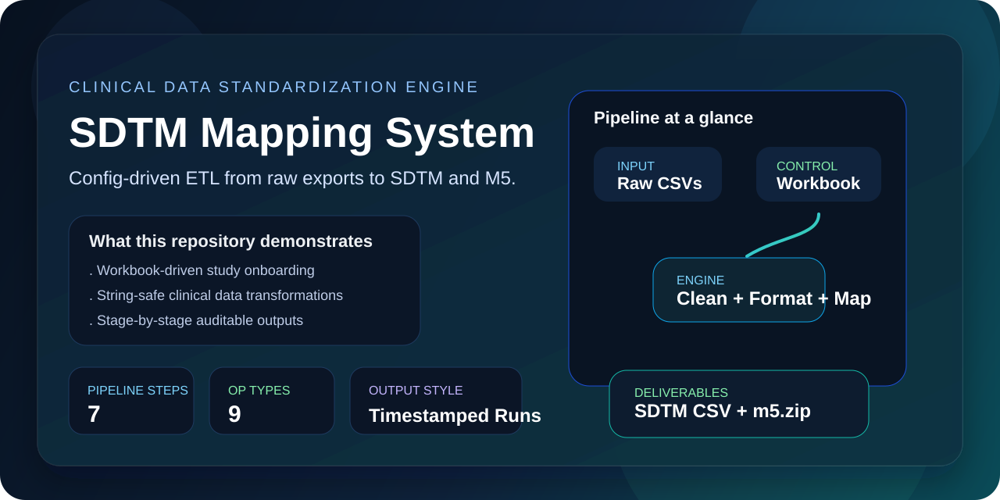
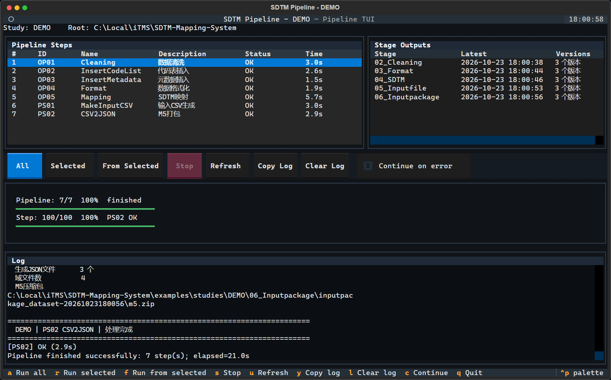
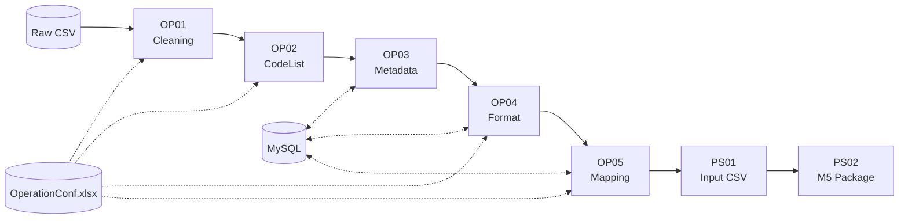

<div align="center">

[English](README.md) | [中文](README_CN.md)

<!-- Typing SVG -->
<a href="https://git.io/typing-svg">
  
</a>

<p><strong>Transform raw clinical study data into CDISC SDTM datasets and M5 submission packages<br/>through a 7-step automated pipeline driven entirely by Excel configuration.</strong></p>

<!-- Badge wall -->
[](https://python.org)
[](https://pandas.pydata.org)
[](https://numpy.org)
[](https://dev.mysql.com/doc/connector-python/en/)
[](https://www.cdisc.org/standards/foundational/sdtm)
[](LICENSE)
[]()

<br/>

<!-- Hero banner -->


<br/>

[Features](#-features) · [Quick Start](#-quick-start) · [How It Fits Together](#-how-it-fits-together) · [Documentation](#-documentation) · [Tests](#-tests) · [Tech Stack](#-tech-stack)

</div>

---

## About

**SDTM Mapping System** (codename **VAPORCONE**) turns raw clinical study exports into CDISC SDTM
datasets and an M5 submission package. The mapping rules live in an Excel workbook
(`<STUDY>_OperationConf.xlsx`); a 7-step pipeline, backed by MySQL, does the rest. A new study
needs a workbook and, only where Excel cannot express the logic, a few Python functions.

## ✨ Features

| | Feature | Description |
|---|---------|-------------|
| 📋 | **Excel as the DSL** | 9 sheets describe the raw files, code lists and one row per SDTM variable; no Python needed for ordinary mappings |
| 🧩 | **9 operation types + guards** | `DEF` `FIX` `FLG` `IIF` `COB` `CDL` `SEL` `PRF` `TPL`, plus `&FIELD:VALUE` guard lines usable on any of them |
| 🔗 | **7 independent steps** | OP01–OP05 transform, PS01–PS02 package; run all, one, or a range |
| 🖥️ | **Terminal UI and CLI** | `sdtm <STUDY>` with live step progress and stage outputs; `sdtm <STUDY> run all` for one shot; a batch runner with `--continue` / `--dry-run` |
| 🗂️ | **Studies live outside the repo** | Each study is a folder in your own private location, chosen at run time; clinical data never enters this history |
| 🗄️ | **MySQL transformation hub** | Code lists and metadata are staged in MySQL with auto-created indexes and an optimised view |
| 🕐 | **Timestamped, auditable output** | Every run writes a new `<stage>/<name>_dataset-YYYYMMDDHHMMSS/` folder; earlier runs are kept |
| 📦 | **M5 packaging** | Domain CSVs, `SUPP--` files and the M5 directory structure, zipped for submission |
| 🚀 | **Built for volume** | Vectorised pandas/numpy, per-domain multiprocessing, precomputed rules, CSV cache, batched DB loads |
| 🌐 | **CJK-aware console** | Japanese / Chinese text lines up correctly in tables and progress output |
| 🧪 | **Runnable DEMO + tests** | A fake 3-subject study runs end to end; the pytest suite needs no database |

---

## 🚀 Quick Start

Needs Python 3.11+ and a MySQL server whose user may create databases.

```bash
git clone https://github.com/hakupao/SDTM-Mapping-System.git
cd SDTM-Mapping-System
pip install -r requirements.txt
```

Create `project.local.json` in the repository root:

```json
{ "STUDIES_ROOT_PATH": "examples/studies", "DEFAULT_STUDY": "DEMO",
  "DB_HOST": "127.0.0.1", "DB_USER": "root", "DB_PASSWORD": "root" }
```

Run the bundled DEMO study through all 7 steps (about 20 seconds):

```bash
python sdtm.py DEMO run all      # Windows: sdtm DEMO run all
python sdtm.py DEMO              # or open the Terminal UI and press a
```

The M5 package appears under `examples/studies/DEMO/06_Inputpackage/`. Next: set up your own
study with [docs/getting-started.md](docs/getting-started.md).

<div align="center">

</div>

---

## 🧭 How It Fits Together

```
SDTM-Mapping-System/
├── sdtm.py / sdtm.bat     ← start here: the one entry point (TUI, console, run, status)
├── pipeline/              ← the core
│   ├── VC_BC01 … BC06     base: settings, utilities, Excel parser, mapping engine
│   ├── VC_OP01 … OP05     steps 1–5: cleaning → code list → metadata → format → SDTM mapping
│   ├── VC_PS01 … PS02     steps 6–7: domain CSVs + SUPP-- → M5 package
│   └── sdtm_study.py      which study to run, where its folder is
├── app/                   TUI, shared step runner, batch runner
├── examples/studies/DEMO/ a complete runnable study: workbook, raw CSV, study functions
├── tests/                 pytest suite (DEMO workbook, no database)
└── docs/                  getting started, architecture, configuration, CLI

<STUDIES_ROOT_PATH>/<STUDY_ID>/   ← your study, in a separate private folder or repo
├── <STUDY_ID>_OperationConf.xlsx   mapping rules
├── VC_BC05_studyFunctions.py       study-specific Python (Combine)
├── 01_RawData/                     input
└── 02_Cleaning/ … 06_Inputpackage/ output of each step, timestamped
```



Reading the code? Start with `pipeline/VC_OP05_mapping.py` (applies the Mapping sheet), then
`VC_BC03_fetchConfig.py` (how the workbook is parsed) and `VC_BC06_operateTypeFunctions.py`
(the operation types).

---

## 📚 Documentation

| Document | Read it when you want to |
|----------|--------------------------|
| [Getting started](docs/getting-started.md) | install, run the DEMO, create your own study |
| [Architecture](docs/architecture.md) | understand the 7 steps, the module numbering and the two-repo layout |
| [Configuration](docs/configuration.md) | write an `OperationConf.xlsx`: sheets, operation types, guards, `study.json` |
| [TUI & CLI](docs/cli.md) | look up a command or a TUI key |
| [DEMO study](examples/studies/DEMO/README.md) | see a minimal workbook explained sheet by sheet |
| [Engine notes](docs/AGENT_KNOWLEDGE.md) | change the engine (AI agents: see also [CLAUDE.md](CLAUDE.md)) |

---

## 🧪 Tests

```bash
pip install -r requirements-dev.txt
pytest -q                        # about 3 seconds, no MySQL needed
```

After changing the mapping engine, also run the DEMO end to end (`python sdtm.py DEMO run all`).

---

## 🧰 Tech Stack

| Package | Version | Purpose |
|---------|:-------:|---------|
| Python | 3.11+ | Runtime |
| mysql-connector-python | 9.4.0 | MySQL connectivity |
| pandas | 2.3.1 | Data transformation |
| numpy | 2.2.6 | Vectorised operations |
| openpyxl | 3.1.5 | Reading `OperationConf.xlsx` |
| python-dateutil | 2.9.0 | Date parsing |
| textual | 8.2.5 | Terminal UI |
| pytest *(dev)* | 8.3.3 | Test suite |

MySQL 5.7 or 8.x is the database server.

---

## 📄 License

Distributed under the MIT License. See [LICENSE](LICENSE).
Questions and bugs: [GitHub Issues](https://github.com/hakupao/SDTM-Mapping-System/issues) · ideas and usage questions: [GitHub Discussions](https://github.com/hakupao/SDTM-Mapping-System/discussions).

<div align="center">

<a href="https://github.com/hakupao/SDTM-Mapping-System/graphs/contributors">
  
</a>

</div>
