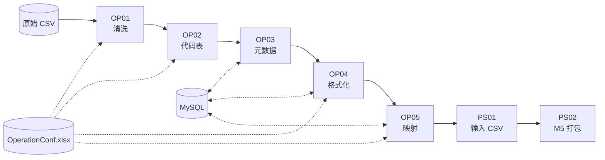

<div align="center">

[English](README.md) | [中文](README_CN.md)

<!-- Typing SVG -->
<a href="https://git.io/typing-svg">
  
</a>

<p><strong>通过 Excel 配置驱动的 7 步自动化流水线，<br/>将原始临床研究数据转换为 CDISC SDTM 数据集和 M5 监管提交包。</strong></p>

<!-- Badge wall -->
[](https://python.org)
[](https://pandas.pydata.org)
[](https://numpy.org)
[](https://dev.mysql.com/doc/connector-python/en/)
[](https://www.cdisc.org/standards/foundational/sdtm)
[](LICENSE)
[]()

<br/>

<!-- Hero banner -->


<br/>

[快速开始](#-快速开始) · [项目结构](#-项目结构) · [文档](#-文档) · [测试](#-测试)

</div>

---

## 关于

**SDTM Mapping System**（代码名 **VAPORCONE**）把临床研究的原始导出数据转换成 CDISC SDTM 数据集和
M5 提交包。映射规则写在 Excel 工作簿（`<STUDY>_OperationConf.xlsx`）里，剩下的交给一条以 MySQL
为中转的 7 步流水线。新建一个研究，只需要一份工作簿；Excel 写不出来的逻辑，再补几个 Python 函数。

- **Excel 即 DSL**：9 张表描述原始文件、代码表，以及每个 SDTM 变量一行的映射规则；
  9 种处理类型（`DEF` `FIX` `FLG` `IIF` `COB` `CDL` `SEL` `PRF` `TPL`），外加 `&FIELD:VALUE` 守卫条件
- **7 个独立步骤**：OP01–OP05 做转换，PS01–PS02 做打包；每次运行都输出到带时间戳的文件夹
- **终端界面和命令行**：`sdtm <STUDY>` 实时显示进度；`sdtm <STUDY> run all` 跑完即退出
- **研究数据不进本仓库**：临床数据留在你自己的私有研究目录里
- **可运行的 DEMO 和测试**：3 名虚构受试者的研究能从头跑到尾；pytest 不需要数据库

---

## 🚀 快速开始

需要 Python 3.11+，以及一个账号有建库权限的 MySQL。

```bash
git clone https://github.com/hakupao/SDTM-Mapping-System.git
cd SDTM-Mapping-System
pip install -r requirements.txt
```

在仓库根目录新建 `project.local.json`：

```json
{ "STUDIES_ROOT_PATH": "examples/studies", "DEFAULT_STUDY": "DEMO",
  "DB_HOST": "127.0.0.1", "DB_USER": "root", "DB_PASSWORD": "root" }
```

用自带的 DEMO 研究跑完 7 步（约 20 秒）：

```bash
python sdtm.py DEMO run all      # Windows 下也可以：sdtm DEMO run all
python sdtm.py DEMO              # 或打开终端界面，按 a
```

M5 包会生成在 `examples/studies/DEMO/06_Inputpackage/` 下。接下来建立自己的研究，见
[docs/getting-started.md](docs/getting-started.md)。

<div align="center">

</div>

---

## 🧭 项目结构

```
SDTM-Mapping-System/
├── sdtm.py / sdtm.bat     ← 从这里开始：唯一入口（TUI、控制台、run、status）
├── pipeline/              ← 核心代码
│   ├── VC_BC01 … BC06     基础层：设置、工具、Excel 解析、映射引擎
│   ├── VC_OP01 … OP05     第 1–5 步：清洗 → 代码表 → 元数据 → 格式化 → SDTM 映射
│   ├── VC_PS01 … PS02     第 6–7 步：各域 CSV + SUPP-- → M5 包
│   └── sdtm_study.py      决定跑哪个研究、研究目录在哪
├── app/                   TUI、共用的步骤执行器、批量运行脚本
├── examples/studies/DEMO/ 完整可运行的示例研究：工作簿、原始 CSV、研究函数
├── tests/                 pytest 测试（读 DEMO 工作簿，不连数据库）
└── docs/                  上手、架构、配置、命令行文档

<STUDIES_ROOT_PATH>/<STUDY_ID>/   ← 你的研究，放在单独的私有目录或仓库
├── <STUDY_ID>_OperationConf.xlsx   映射规则
├── VC_BC05_studyFunctions.py       研究专用的 Python（Combine）
├── 01_RawData/                     输入
└── 02_Cleaning/ … 06_Inputpackage/ 各步骤的输出，带时间戳
```



想读代码的话，先看 `pipeline/VC_OP05_mapping.py`（执行 Mapping 表），再看 `VC_BC03_fetchConfig.py`
（工作簿怎么解析）和 `VC_BC06_operateTypeFunctions.py`（各处理类型）。

---

## 📚 文档

| 文档 | 什么时候看 |
|------|-----------|
| [上手指南](docs/getting-started.md) | 安装、跑 DEMO、建自己的研究 |
| [架构](docs/architecture.md) | 了解 7 个步骤、模块编号的含义、两个仓库的关系 |
| [配置](docs/configuration.md) | 编写 `OperationConf.xlsx`：各表、处理类型、守卫条件、`study.json` |
| [TUI 与命令行](docs/cli.md) | 查命令或 TUI 快捷键 |
| [DEMO 研究](examples/studies/DEMO/README.md) | 看一份最小工作簿的逐表说明 |
| [引擎说明](docs/AGENT_KNOWLEDGE.md) | 改引擎时看（AI 助手另见 [CLAUDE.md](CLAUDE.md)） |

上面的文档目前只有英文版。

---

## 🧪 测试

```bash
pip install -r requirements-dev.txt
pytest -q                        # 约 3 秒，不需要 MySQL
```

改动映射引擎后，还要把 DEMO 完整跑一遍（`python sdtm.py DEMO run all`）。

---

## 📄 许可证

基于 MIT 许可证分发，详见 [LICENSE](LICENSE)。
问题反馈：[GitHub Issues](https://github.com/hakupao/SDTM-Mapping-System/issues)。

<div align="center">

<a href="https://github.com/hakupao/SDTM-Mapping-System/graphs/contributors">
  
</a>

</div>
