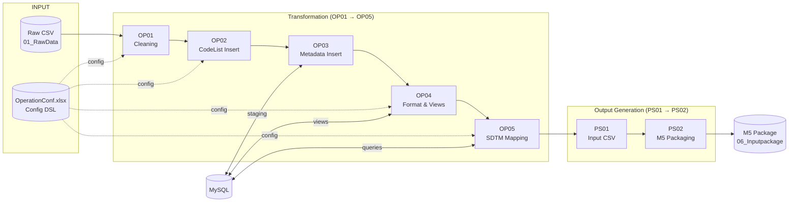

# Architecture

## Two repositories

```
C:\...\SDTM-Mapping-System\      ← this repo (public): the program
C:\...\SDTM-Studies\             ← your repo (private): one folder per study
    └── <STUDY_ID>\
        ├── <STUDY_ID>_OperationConf.xlsx   mapping rules (Excel DSL)
        ├── VC_BC05_studyFunctions.py       study-specific Combine functions
        ├── study.json                      optional settings
        ├── 01_RawData\                     raw CSV exports (input)
        └── 02_Cleaning\ … 06_Inputpackage\ pipeline outputs (timestamped)
```

The program never contains study data. `project.local.json` (machine settings) says where
the studies are; the study to run is chosen at run time (`sdtm <STUDY>`, `--study`, or the
`SDTM_STUDY` environment variable). The DEMO study under `examples/studies/` has the same
layout.

## Repository layout

```
SDTM-Mapping-System/
├── sdtm.py / sdtm.bat     entry point: TUI, line console, one-shot run/status
├── pipeline/              the core: engine modules + the 7 stage scripts
├── app/                   the shell around it: TUI, shared runner, batch runner
├── examples/              project.local.json example + runnable DEMO study
├── tests/                 pytest suite (DEMO workbook, no database)
└── docs/                  these documents
```

### `pipeline/` — module numbering

Module names follow `VC_<LAYER><NN>_<name>.py`. The layer tells you the role:

| Layer | Meaning | Modules |
|:-----:|---------|---------|
| **BC** | Base: shared constants, utilities and the mapping engine | `VC_BC01_constant` project/study settings, DB settings, SDTM field lists · `VC_BC02_baseUtils` logger, filesystem, `DatabaseManager`, progress · `VC_BC03_fetchConfig` parses and validates `OperationConf.xlsx` · `VC_BC04_operateType` applies Mapping rules, joins, CSV cache · `VC_BC06_operateTypeFunctions` the operation types (`DEF` … `TPL`) and guard lines |
| **OP** | Operation: the transformation steps 1–5 | `VC_OP01_cleaning` … `VC_OP05_mapping` |
| **PS** | Post: output generation, steps 6–7 | `VC_PS01_makeInputCSV`, `VC_PS02_csv2json` |

`VC_BC05_studyFunctions` is the one number missing here: it lives in each study folder and is
put on `sys.path` by `VC_BC04` at run time.

`pipeline/sdtm_study.py` resolves which study to run and where its folder is; `VC_BC01`
imports it, as do the runners in `app/`.

Imports go one way: `BC01 → BC02 → BC03 → BC04/BC06 → OP/PS`. Each stage script starts with
`from VC_BC03_fetchConfig import *` (and `VC_BC04_operateType` for OP04/OP05). The modules are
plain scripts, not a package: every stage runs in its own process as
`python pipeline/VC_OPxx_*.py`, and the study's `VC_BC05_studyFunctions.py` imports the engine
by the same bare module names.

### `app/`

| File | Role |
|------|------|
| `sdtm_core.py` | the step table, stage-output status, and `iter_pipeline_events()` which launches the stage scripts one by one and turns their output into events |
| `sdtm_tui.py` | the Textual terminal UI, built on those events |
| `run_pipeline.py` | non-interactive batch runner (`--continue`, `--dry-run`) |

`sdtm.py` in the root adds `pipeline/` and `app/` to `sys.path` and dispatches to the TUI or
the line console.

## The 7 steps



| # | Module | Step ID | What it does |
|:-:|--------|:-------:|--------------|
| 1 | `VC_OP01_cleaning` | OP01 | Filter raw CSV by the Patients sheet, drop unmapped columns and invalid rows |
| 2 | `VC_OP02_insertCodeList` | OP02 | Insert the CodeList sheet into MySQL |
| 3 | `VC_OP03_insertMetadata` | OP03 | Normalise values (dates to ISO 8601, …) and load the cleaned data into MySQL |
| 4 | `VC_OP04_format` | OP04 | Build the indexed TRANSDATA view, export formatted CSVs, run Combine functions |
| 5 | `VC_OP05_mapping` | OP05 | Apply the Mapping sheet per SDTM domain (multiprocessing), number `--SEQ` |
| 6 | `VC_PS01_makeInputCSV` | PS01 | Split into main domain CSVs and `SUPP--` files |
| 7 | `VC_PS02_csv2json` | PS02 | Build the M5 package (JSON + directory structure + zip) |

### Data flow on disk

```
01_RawData/                                   raw CSV files
    │  [OP01]
02_Cleaning/cleaning_dataset-<timestamp>/
    │  [OP02] CodeList  ─▶ MySQL CODELIST table
    │  [OP03] Metadata  ─▶ MySQL METADATA table
    │  [OP04] TRANSDATA view ─▶
03_Format/format_dataset-<timestamp>/          F- files, Combine output
    │  [OP05]
04_SDTM/sdtm_dataset-<timestamp>/
    │  [PS01]
05_Inputfile/inputfile_dataset-<timestamp>/    domain CSVs + SUPP--
    │  [PS02]
06_Inputpackage/inputpackage_dataset-<timestamp>/
    └── m5/…/tabulations/sdtm/
```

Every run writes a new timestamped folder; each step reads the latest folder of the step
before it. Table and view names come from the study id (`VC05_<STUDY_ID>_CODELIST`, …) and
can be overridden in `study.json`.

Engine internals (how Mapping rows are evaluated, `NDKEY`, Combine overlay, conventions) are in
[AGENT_KNOWLEDGE.md](AGENT_KNOWLEDGE.md).
