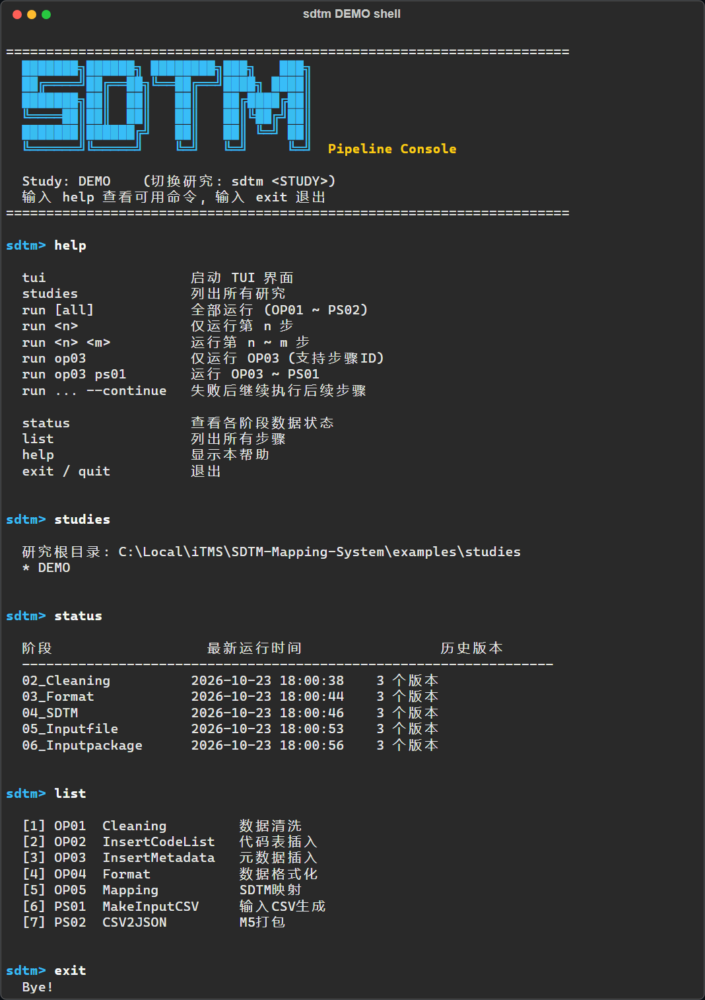

# TUI & CLI Reference

## Entry point (`sdtm.py` / `sdtm.bat`)

```bash
sdtm <STUDY>                      # Open the TUI for a study (same as python sdtm.py <STUDY>)
sdtm <STUDY> shell                # Line console instead of the TUI
sdtm <STUDY> run all              # One-shot: run and exit
sdtm <STUDY> status               # One-shot: show stage outputs
sdtm studies                      # List studies under STUDIES_ROOT_PATH
sdtm --study <STUDY> status       # Same as sdtm <STUDY> status
```

`<STUDY>` may be omitted when `SDTM_STUDY` / `DEFAULT_STUDY` is set or only one study exists.
If `textual` is not installed, `sdtm` falls back to the line console.

## Terminal UI

<div align="center">

</div>

<br/>

Pick a step in **Pipeline Steps**, then run it alone or from there to the end. **Stage Outputs**
shows the latest timestamped folder and version count of each stage; the log is also written
to `logs/sdtm_tui_<timestamp>.log` under the folder you started `sdtm` from.

| Key | Action |
|:---:|--------|
| `a` | Run all 7 steps |
| `r` | Run the selected step |
| `f` | Run from the selected step to PS02 |
| `s` | Stop the running pipeline |
| `u` | Refresh stage outputs |
| `c` | Toggle *Continue on error* |
| `y` / `l` | Copy log / clear log |
| `q` | Quit |

## Line Console (`sdtm <STUDY> shell`)

<div align="center">

</div>

<br/>

| Command | Description |
|---------|-------------|
| `tui` | Switch to the TUI |
| `run all` | Run all 7 steps (OP01 ~ PS02) |
| `run <n>` | Run step n only |
| `run <n> <m>` | Run steps n through m |
| `run op03` | Run OP03 only (step IDs are case-insensitive) |
| `run op03 ps01` | Run by step ID (case-insensitive) |
| `run ... --continue` | Continue past failures |
| `status` | Show latest output timestamps and version counts |
| `studies` | List available studies |
| `list` | List all pipeline steps |
| `help` | Show available commands |
| `exit` | Quit the console |

## Batch Runner (`app/run_pipeline.py`)

```bash
python app/run_pipeline.py --study MYSTUDY    # Run all 7 steps for MYSTUDY
python app/run_pipeline.py 3                  # From step 3 onward (study from env / DEFAULT_STUDY)
python app/run_pipeline.py 3 5                # Steps 3 to 5 only
python app/run_pipeline.py --continue         # Continue past failures
python app/run_pipeline.py --dry-run          # Preview execution plan without running
```

## Individual Steps

Each step module can be run standalone:

```bash
python pipeline/VC_OP01_cleaning.py
python pipeline/VC_OP05_mapping.py
python pipeline/VC_PS02_csv2json.py
```
